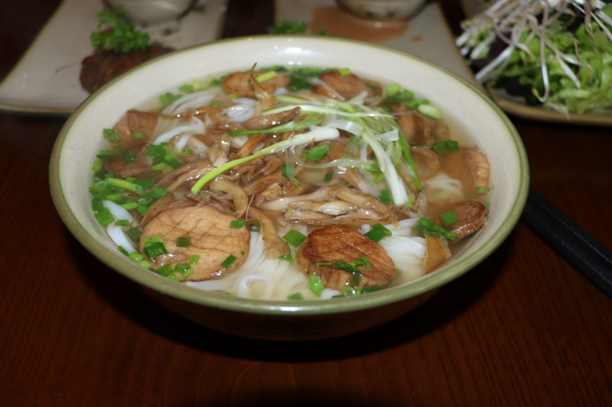
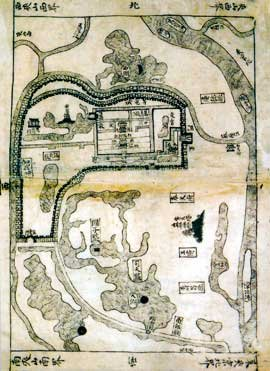
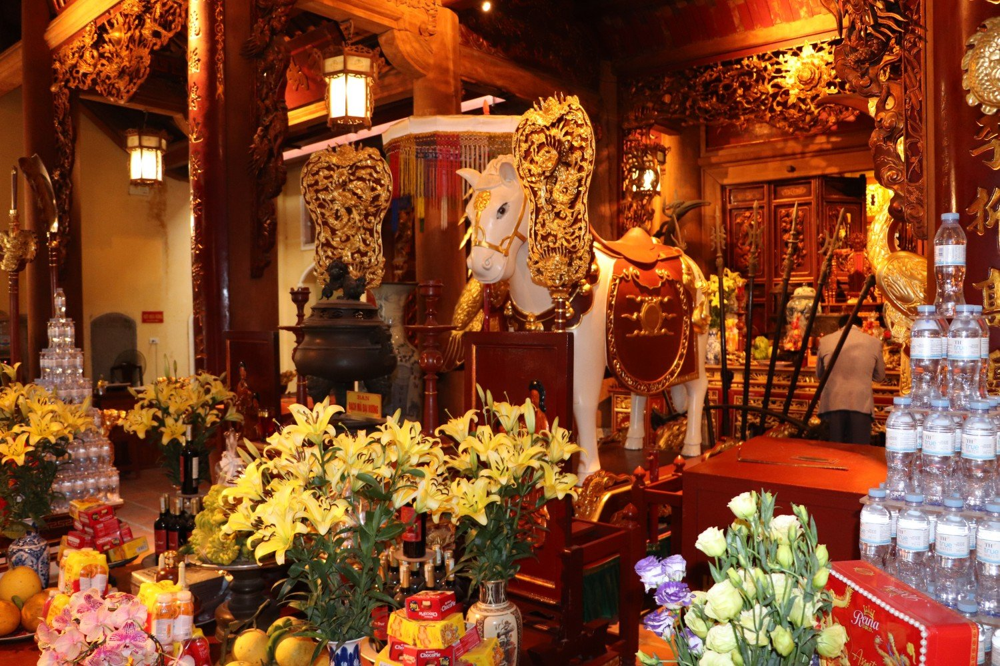
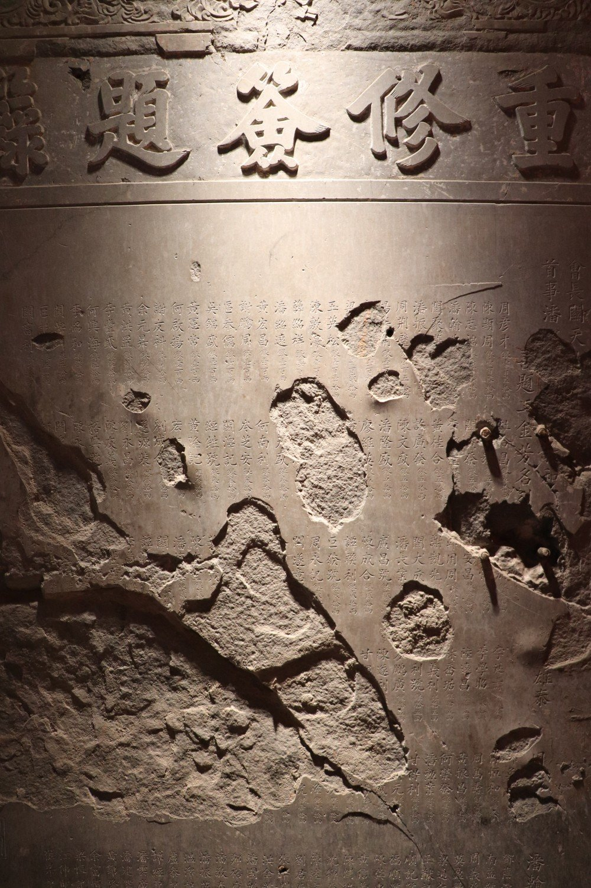
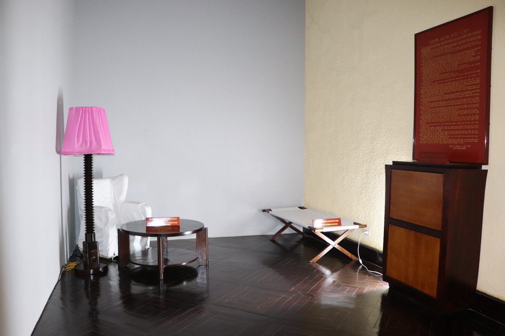
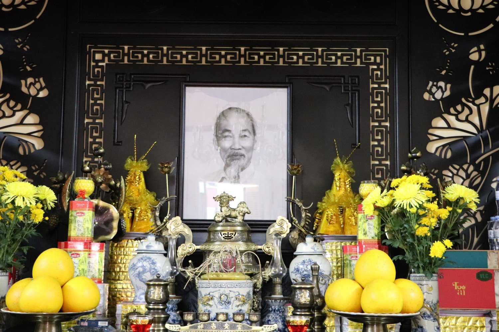
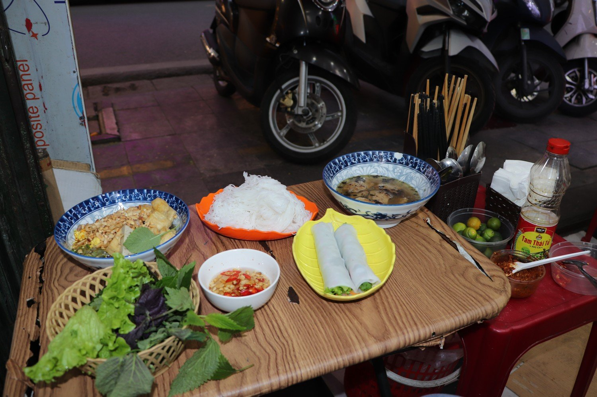

「東京」（Tonkin）是河內的古稱，也是法國人對於河內通用的稱呼，這個名字一直延續到1945年法國結束殖民統治後，才被更改。相比於日本江戶的東京，河內自七世紀以來就使用東京，早了江戶一千多年。「散策」在日語中指悠閒漫步、閑晃的意思，近來日本旅行者流行以「散策」來紀錄他們的旅程，因此我也詼諧地以「東京散策」來書寫我在河內十天所看到的種種。

> 河內對外地人具有一種特殊的吸引力。在遙遠村落的深巷盡頭，或在山林深處的密林裡，黃昏時分，仍有許多人朝著某一個方向凝望，努力想看見河內的燈光映照在雲層上的微微亮色。為了那些嚮往京城的人，也為了居住在河內的人，我們應當鼓勵彼此更加熱愛河內，談論河內一切獨特的地方，讓三十六街坊中的每一個變化，都能在各處激起回聲。
>
> ——石嵐，《河內三十六條街》1944

如同二十世紀中期河內文學家石嵐所說，河內對於外地人而言，是有一種無法抗拒的吸引力。作為本地人，他以富有鄉情的視角透視這座千年京城的情感紋理。不過，石嵐之所以厲害，是他還敏銳地捕捉到了旅人的感受，她發現外地人同樣在盡力捕捉對河內的記憶以及文學性的想像。作為一位北方島嶼來的旅客，我想像若是這位英年早逝的才女還在世（根本不可能），他會發現河內變得十分不同，他或許會厭惡、會失落。不過，作為一位北方來的異鄉客，我會告訴她在眩人耳目的霓虹燈招牌和擾人的喇趴聲下，仔細地去觀察，仍然能清楚聽到聖若瑟座堂中的鐘聲，始終迴盪昇龍城的回音。

造訪河內，也是我初次到越南。若要問我對於對越南感受是什麼，只能説這座城市如同在美術館所看見法屬時期越南畫家印象派的畫作一般，河內是一座無法以寫實風來描繪的一座古城，他交錯著越南、中華和法蘭西的意象，並且這些元素都很自然地在充滿柚香的空氣中雜揉。會稱為古城除了他真的很老之外，我總覺得無論多新的事物，彷彿一定會被昇龍或是法殖時期的記憶，刷上一層仿古色調。

一到河內機場，刺鼻的焦味和粉塵的顆粒感隨即竄入鼻竅。早聞河內的空氣品質是世界第一差，但真正經過機場通往城區的日新大橋，還是被霧濛濛的城景所震撼。究竟是多少的人、多少的煙火才能讓城市染上這一層厚重的簾幕，後來我發現這並不是簾幕，我早已身處其中。頭一天晚上到河內，這座城市讓我顯得十分不安。惡劣的空氣、施工的粉塵、人煙稀少的街弄，讓我有些失望。我無法想像十天之後我竟會對這座城市產生巨大的戀慕。

由於到了住處已晚，在河內的第一餐，我和Ko只是在住所附近的poke草草了事。隔日一早起床，我和旅伴便前往老城區探索。老城區是河內自古以來的商業區，自李朝遷都昇龍以來，便是萬商雲集之地。十七世紀已降，由於中國商人的進入（主要來自閩粵二省），使得這裏的貿易達到鼎盛，法屬時期又有印度和法國商人進入，是當時亞洲最為繁榮的城市之一。老城區古稱三十六坊，保存了出自《周禮》的街坊制度。便是以皇城為中心，將市集向左右兩邊擴展的設計。若以昇龍皇城的座標，其實當前的老城區只保留了一半的街坊。老城區的街坊中儘管在觀光化之下，過去安排有序的街道分工，已經些許交錯，不過主要仍然可以看見當地居民的專業化分工，毎條街道都販售著不同的商品

在老城區的第一餐，我們找了一間網路評價甚高的素食餐廳。分別點了河粉、番茄米線、春捲和香腸。在微冷的早晨，望著梧桐、洋樓和摩托車交錯的街景，吃一碗溫熱的河粉，無疑是人生最為享受的事。

河粉作為世界對越南的第一印象，其實成為國菜是相當晚近的事。越南史家武紅蓮指出，河粉是法屬時期出現於北越的產物，有兩派說法，一是當時小販挑著扁擔賣給熬夜執勤法國衛兵的早餐．二則是受到法餐的食牛文化影響，發展出來的越南飲食而大家所熟知的牛肉河粉，則是法國殖民所帶來的產物。受中國文化影響，以農業為主的越南，本身其實並不食牛肉．在法國人帶入食牛文化後，這種肉類才大為流行。

不同於臺灣常吃到會加九層塔、檸檬的南越河粉，北越河粉的口味較為清淡，以牛肉為主。通常就只有蔥和香菜作為佐料，湯頭也以清淡甘甜為主。（武紅蓮，越南美食史第六章）

<figure class="post-fig"><figcaption>煎杏鮑菇河粉</figcaption></figure>

> **店家**：Chayfood 
> **地址**：66 P. Nguyễn Hữu Huân, Hàng Bạc, Hoàn Kiếm, Hà Nội

對於這趟旅程的想像和設定，我們以看廟為優先，因此並沒有像大多數人一樣，安排到鄰近的下龍灣或是寧平去看自然風景。而是完全深入這一座城市。這趟旅行的探索藍圖，主要是以昇龍城的範圍為主，我參考了阮朝的文獻《河城靈跡古錄》中所描繪的四鎭祠，作為主要的活動範圍。這四座廟分別鎮守皇城的四方，四方之內也是皇城居民主要的活動範圍。

<figure class="post-fig"><figcaption>河內古地圖</figcaption></figure>

我們首先參訪了鎮守東方的白馬祠。白馬祠興建於九世紀，主祀龍肚神。龍肚是河內本土的神祇，據說在唐朝時，十世紀，丁部領率軍平亂之際，曾至大羅城東之白馬祠祈禱神明庇佑國家，隨後便成功平定十二使君之亂。統一天下，丁皇夜夢一神自稱白馬神，告曰：「臣奉皇天之命，隨陛下征討群敵。如今天下已定，而陛下尚未行報謝之禮，實非禮制。」帝醒後，知其神靈顯赫，遂賜美號，命民眾於皇后楊氏月之故里另建白馬神祠以奉祀，名為靈郎白馬神祠。

另一個傳說是李朝開國君主李公蘊定都昇龍城後，城牆屢次崩塌。他便到白馬祠祭拜龍肚神，祭拜之際，白馬祠衝出一隻白馬，並且循著昇龍留下了足跡，李公蘊於是在白馬留下的足跡上建築城牆，城牆便堅固屹立。李公蘊經歷神跡顯現後，便將龍肚封為昇龍的城隍。因此在白馬祀中，還可以見到供奉白馬的雕像。

<figure class="post-fig"><figcaption>白馬祠的白馬神像</figcaption></figure>

白馬祠一旁，就是知名的粵東會館。當代代河內不同於西貢，唐人街已經沒有居住華人。在1970年代的排華政策之下，大多的華人皆已經離開河內。然而，早期華人的足跡卻仍然保存完善。越南的華人族群複雜，有明末因政權更替而移民的明鄉人，以及清代因商業貿易移居的清人。兩者雖然都是華人，不過族群認同卻不一樣。位於老城區的華人，主要是在黎朝後期遷入。雖然早期有明鄉人和清人之分，不過到了近代，其實已經看不見兩者的差異與痕跡，除了籍貫之外，早已混居。

在阮朝的《大南一統志》中就記載河內唐人街的樣貌：

> 河口庯，在壽昌縣地，商戶清人問處，列賣書籍、北貨、藥材，亦名行帆。
>
> 粵東庯，明鄉客戶舊處新居，殖貨居其之所。
>
> 福建庯，列賣銅器

老城區的華人街，主要有兩條，一條是粵人聚居的行帆街，早期主要販售帆布。一條則是閩人聚居的懶翁街，法國時期稱為福建街（），早期主要販售藥材。

從建築上來看，粵東會館的規模較福建會館的規模大得多，反映了廣東人在分佈上的優勢。按華人的移民分佈來看，十七世紀以來河內的商業貿易以廣府人以及潮州人為多，福建人較少。研究顯示，潮州商人主要販售

目前的粵東會館已經被改造為展覽館的形式，裡頭展出各種現代的藝術品。不過，若是細心繞到後面的兩個院落，可以發現，這裏奉祀著粵人的海神媽祖，一旁還有千順將軍的神像。在神壇的一旁，有重修會館的碑文，從碑文的姓氏來判斷，粵東會館應是同時有潮州與廣府的商號。碑文上的保存狀態並不好，受到越戰的破壞，上面還卡著一顆戰爭時所留下的子彈。不起眼的碑文中，道出河內華人百年的心酸史，從十七世紀的華人移民，到越戰，一直到越共建國後華人的驅除。

粵東會館曾經是孫文流亡越南的根據地，據傳他在此處規劃了黃花崗起義以及惠州起義，並且結識了越南的維新義士潘佩珠，在東亞近代的政治史中，粵東會館的歷史若是詳細爬梳似乎足夠牽起了日、中、越各國維新義士的網絡。

<figure class="post-fig"><figcaption>充滿彈孔的石碑</figcaption></figure>

<!-- 照片：粵東會館的媽祖（待補） -->

離開粵東會館，我們繞到了胡志明故居。這次的旅程並沒有進入胡志明廟以及其在皇城的故居，反倒是在逛老城區時參觀了他起草《獨立宣言》時的居所。這棟房子原先屬於河內鉅富鄭文寶，鄭氏出生於商業世家，具有橫跨歐亞的商業網絡，同時他也是一名愛國商人，捐贈了大筆的財富支持胡志明的革命事業，在晚年更把居所捐予政府。這棟房子不寬，但倒是非常的長。通風順暢、採光良好，並且有精緻的傢俱和庭院造景。二樓保留了胡氏起草獨立宣言的房間，三樓祭祀著胡志明靈位，以及政府開會議事和鄭氏夫妻的生活。良好的採光以及越法折衷的長樓建築十分吸引我，在逛完整棟樓以後，我和旅伴說道：「要是我有一棟這樣的樓，我就滿足了」

<figure class="post-fig"><figcaption>胡志明起草獨立宣言的房間</figcaption></figure>

<figure class="post-fig"><figcaption>祭祀胡志明的神壇</figcaption></figure>

作為閩人後裔，上回旅遊檳城時我曾打趣說道：「我們華人下南洋第一件事就是找會館」。不過說來慚愧，福建會館卻是當天的最後一個景點。福建會館位於懶翁街，建立於1815年，規模明顯小於粵東會館。這裏不需門票。會館前庭有一個亭子，類似於鹿港龍山寺的風格，藻井十分漂亮。內部同樣供奉海神媽祖，其千順將軍的造像也和臺灣更為相似。會館的另一側則供奉三官大地。當我正興起拍照時，顧廟門的阿伯跑來阻止我，因此在這裏我沒有留下太多的照片。

根據一旁相片的記載，福建會館除了商貿社交的功用之外，本身還有學校的功能。早期福建人將子女送到這邊接受華人教育。越南排華後，福建會館原本的學校，曾經被改為紅河學校。直至近年，才又改回古蹟來保存。

按重修福建會館的捐題錄可以發現福建會館中的族群型態，儘管有少數的福州人，不過會館成員主要仍是以閩南為主，財力也遠超福州人。祖籍地以同安為最多，晉江則最為富有。

繞出福建會館，我們嘗試了在地人的路邊小攤。不同於早上是賣觀光客的精緻餐廳。這間店是當地人最尋常的美食。

我在英文菜單上，糊里糊塗地點到了河內最知名的烤肉米線，旅伴則同樣點了番茄米線。並且我們吃到了我吃過最好吃的越南麵包。

烤肉米線是河內的特色,不同於湯米線，他是清爽的沾麵。原始的版本是將烤豬肉和肉丸浸泡在沾醬中，再以一小團一小團的米線沾著吃，並且會搭配生菜、紫蘇和薄荷。素食的版本我則是吃到類似豆包的素肉丸。我十分喜愛這道菜，一是本身就喜歡米線有嚼勁且彈牙的口感，二是不同於葷食的魚露帶有厚重的腥味，素食沾醬酸甜清爽契合我的口味。

同時我們叫了兩條七塊錢的粉卷，臺灣越南餐廳賣的春捲通常是用米紙所包的腩卷。粉卷的外層則是腸粉，相較於口感較硬的米紙，我更中意粉卷扎實的勁道。越南麵包酥脆的外皮包裹清脆的生菜、酸甜的越氏泡菜以及素火腿，讓我馬上就嗑了一個，原本還想説兩人分著吃，後來都加點了。

<figure class="post-fig"><figcaption>烤肉米線與粉卷</figcaption></figure>

> **店家**：CHAY TÂM KHỞI 
> **地址**：70 Hàng Điếu, Phố cổ Hà Nội, Hoàn Kiếm, Hà Nội
