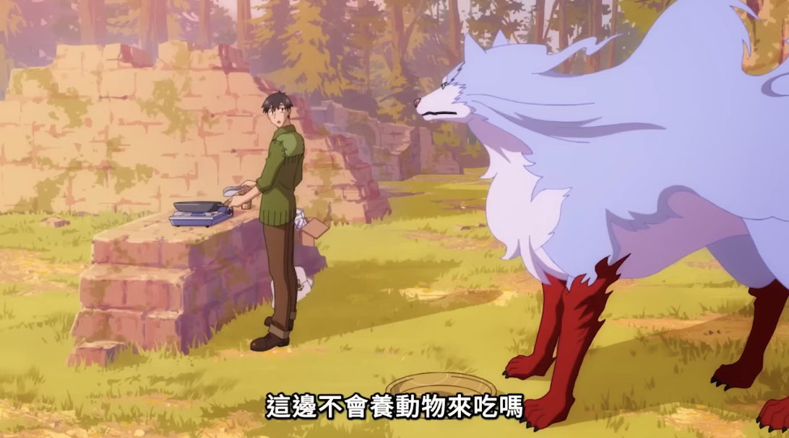

最近剛追完一部很久之前出的的《擁有超常技能的異世界流浪美食家》。劇情雖然俗套，但在異世界作品裡算有趣。主角擅長料理，他的能力是能從異世界叫到現實世界超市的外送。靠著這項技能，他用料理收服了一隻武力強大的魔獸菲爾（外型明顯抄襲《幽靈公主》的山犬）。這隻魔獸靠牠狩獵高等魔物，幫主角快速地升等、轉錢。 有一幕是主角叫了黑毛和牛給菲爾吃。菲爾驚訝這肉竟如此美味，後來才知道在人類世界，牲畜是被特別飼養來吃的；而在異世界，肉類全靠打獵取得，並沒有畜牧文化。這情節讓我想到一個問題：「肉」作為商品，在現代資本主義社會中，是否仍帶有宗教性的神聖意味，或階級結構中的稀缺象徵？還是早已成為日常習慣的一部分？當屠殺變成社會的「描述性常態」（descriptive norm）時，還有人會覺得這不道德嗎？

我承認自己有反社會的傾向，而吃素本身就帶著一點反社會，因為這會阻礙人類「共食」的習性。認識我的人都知道，我在生活中盡可能吃素。儘管我因為身體因素，本身仍剝削蛋雞和奶牛，離全素還有距離，但我相信這是一種漸進的練習。只要持續嘗試，終究能越來越接近心口無異的實踐。我的碩論也關注動物保護問題，不過我不是那種高舉道德旗幟的動保魔人。我反對的其實不是「吃肉」本身，而是現代肉品來源幾乎都來自工業化畜牧（factory farming）。在這體系裡，動物不僅在死亡時受苦，連活著都得經歷極端的虐待。

漁獵採集時代的肉是靠狩獵得來的；農業時代，肉則屬於祭祀或權力階層的特權食物，平民吃肉的機會微乎其微。工業革命之後，畜牧逐漸工廠化，動物成為可販售的商品。牠們從出生到死亡都被控制、餵食、強制交配、與幼崽分離，被注射激素，終年關在潮濕污穢、無日照的空間。這些細節之殘酷，讓我不得不去想一個問題：生命的邊界到底在哪裡？孟子所謂禽獸之辨要如何解決？哈拉瑞的獸、人、神邊界要怎麼去想？

目前願意正視這問題的，大概只剩宗教與少數哲學流派。如果要對抗資本主義這個恐怖的利維坦型宗教還有消費主義這個眾人遵守的「戒律」，傳統宗教反而可能是少數的出路。佛教、基督教、道教、儒教、印度教、耆那教，都曾提出過各自的素食論證。我是希望能從亞伯拉罕諸教、印度諸教、中華諸教的宗教對話中，去看宗教如何共同處理這個世界性的危機。

我們從小就被教導不要傷害生命，這是幼稚園小孩都懂的道理。可是在現代社會，暴力與剝削生命的行為卻被合理化，成為日常。我說句傷人的，不關注這個問題，就是共犯。歷史上，那些默許暴力的人，也不都一樣？十五世紀以降的黑人奴隸主、二戰時支持納粹集中營的德國群眾。從後設角度看，他們當然可惡，但當下他們會這麼想嗎？社會有定他們罪嗎？挪移到當下，我們不也是默許生命被系統性屠殺與利用嗎？

人為何飼養動物？人為何吃動物？無論從學術或生活角度，這都是值得窮盡一生去思考的問題。許多學者研究動物倫理、寫動物研究的文章，但卻怎麼都不願意放下手上的雞腿、餐盤裡的牛排，然後再理直氣壯地找藉口開脫。很荒謬吧

