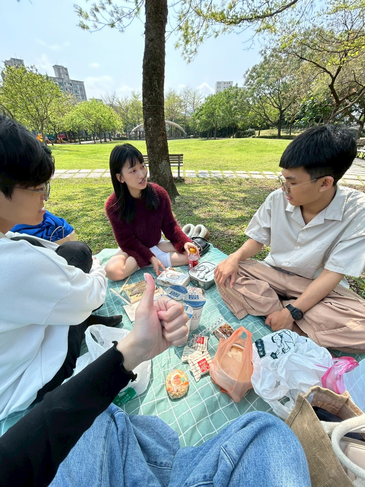

自從我旅居臺北城，才發覺講一年當中，宜人的天氣有夠少。今仔日罕至是好天，氣溫涼爽，閣有日頭。我著恰三个友人佇文山森林公園野餐。阮一面食便當、餅乾、飲料恰水果，一面佇草地面曝日頭，拍抐涼。佇這个節奏緊迫的城市裏底，按呢款的時間真少。短短仔的休憩（きゅうけい），予人會使暫時脫離日常的壓力恰煩惱。食飯飽，阮爬上公園的小山崙，去跙流籠（溜滑梯）。恰逢無人，才會使耍恰盡興。兩點鐘，假若像完全脫離了世俗的生活。我想可能都市仔的日常著是按呢，便是佇這款閬縫當中，尋著一時半刻个心適，今仔日的好天，當是愛感謝天公伯仔个成全。

