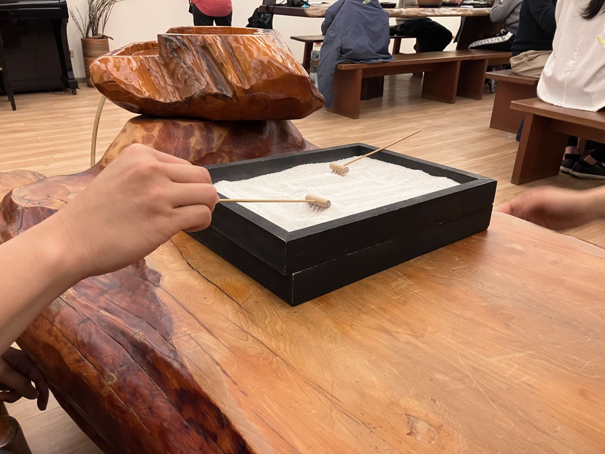
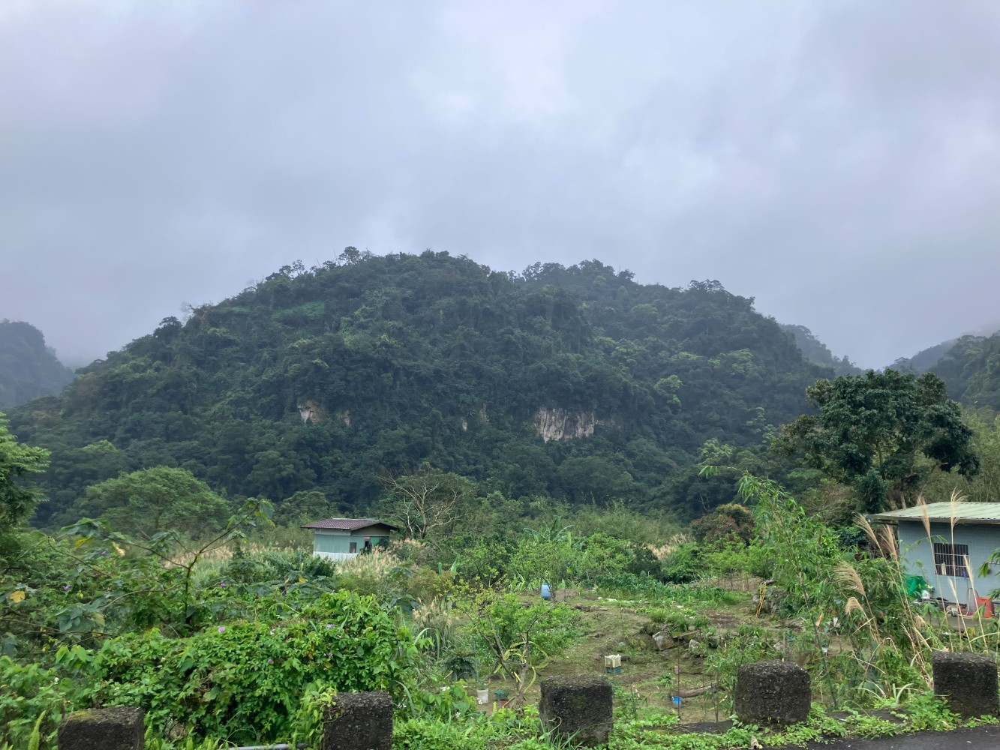
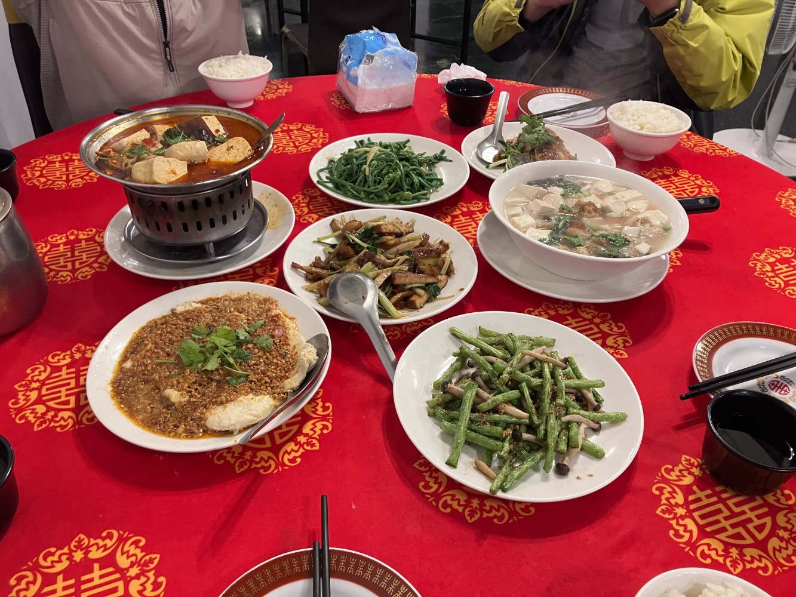
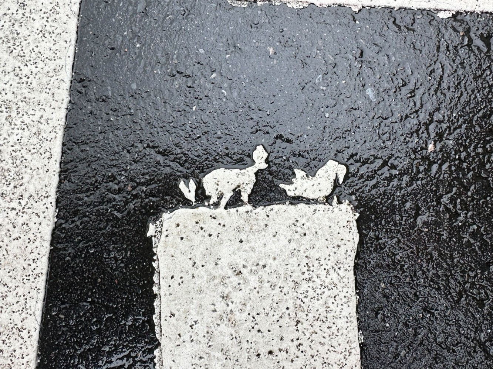
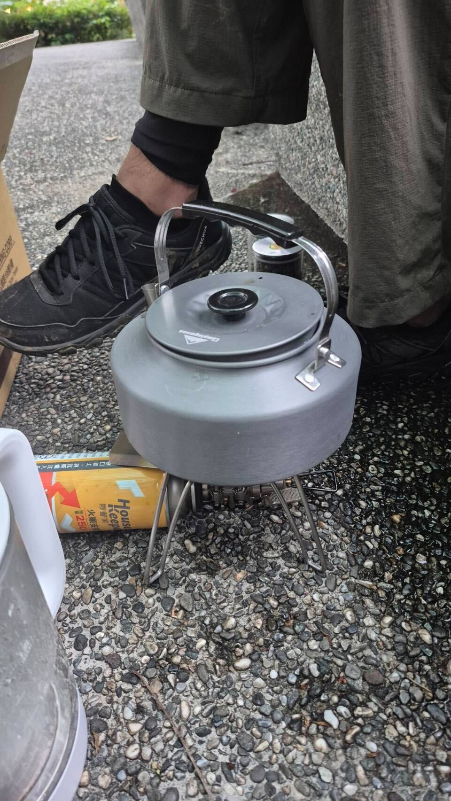

剛剛才想起來是第二次聚會，第一次是去年聖誕節去看寒食帖。第二次聚會花了兩天，第一天我和眾魁、宗恩去德貴學苑參加新春茶敘到下午，結束後又會合旻翰去迪卡儂採購。晚上去艋舺吃麵，到龍山寺逛逛，看看站壁街，又回到萬隆小房間繼續喝茶談天。第二天我們在政大郵局集合，簡單吃了點豆漿飯糰後，就出發爬山。從指南宮上去，爬完二格山，在山上吃完另一顆飯糰。由於天氣突然下雨，擔心危險，決定不爬筆架山，所以我們從南天宮下山。一路經過華藏的靜修中心回到深坑市區吃臭豆腐。本想去樟山寺喝鐵觀音，後來不小心做錯站，只能回文山森林公園喝茶，沖了一支貴妃美人、一支瑞里高山。最後吃了大福利餐廳（全臺北我覺得最好吃的餐廳）當作晚餐，還續攤一碗燒仙草，非常過癮。  
希望之後大家可以參與活動（可能北中南都會有），來認識人，或介紹朋友來。 

