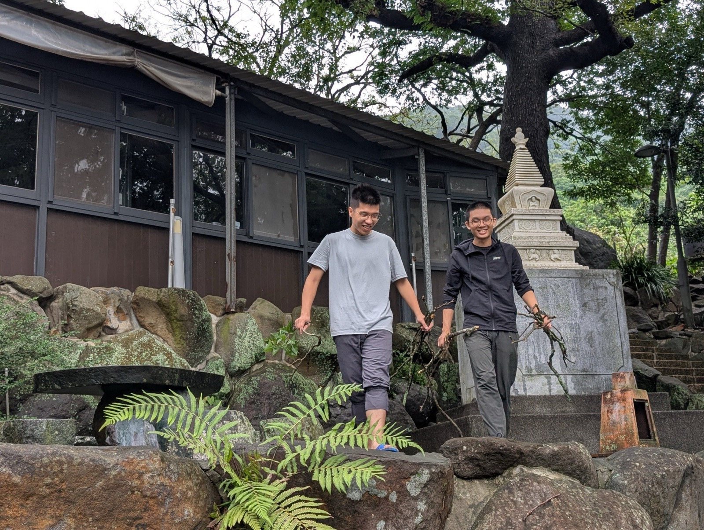

這幾個月下來，做事好像比較沉得住氣了。不論做什麼，心裡總會有個念頭提醒我該幹麼就幹麼。幾年前修習葛印卡老師的內觀禪，我常常只專注在呼吸上，忽略了體驗當下的各種覺受。第四次參加十日課程時，有一天，教禪的王老師突然走到我旁邊，邀請我一仝散步，他緩緩教我走路的方法。我是到那時才知道，原來自己連路都不會走。學佛大約三年，漸漸明白，平日若沒有覺照，讀再多的經論、知識也是枉然，其實正確的用功，不懂教相也無妨。

六月，常妙法師回到禪林，與他相識後，我才發現要用功的地方還很多。吃飯、喝茶、走路、打掃，這些日常的事，很多時候心是散亂的，做起來模模糊糊，並不清楚。有次搬東西，他便問我怎麼把身心放在事情上，我答「我在觀察呼吸」，妙師曰「你這樣是錯的，做事就好好做事，不用觀察呼吸。真正的禪修不是這樣，如果喪失了對於當下事情的覺察，便不是禪修，到時候事情做不好，受傷了更麻煩，不要這麼笨」

喝茶時，我常散心，有時候一不小心茶壺上的蓋子便會掉下來，還因此摔了幾支。也會時常讓水溢出來。一次喝茶時，妙師曰：「你連蓋子都拿到掉下來，還想要改變世界，去死一死吧。」這句話，讓我反省學佛究竟是在學什麼？他真是一位大善知識。我想，先不談名相，學佛的目標和方法大概是一體的，而且很樸實，就是「把人做好，把事做好」。真正要清楚，就得時時覺照，提醒自己該怎麼做就怎麼做，而不是讓注意力一直停在過去、未來，或當下的別處。

時間和空間，大概是人最大的幻覺，卻也是最真實的感受。這樣的幻覺讓人迷惑、讓人顛倒。因為有連續性，人便以為事物是實有的。歷史學希望藉由時間的連續性，以人的想像串起證據，找出人類文明的法則，或者只是留下紀錄。地理學則先劃分出空間，思考場域中人與環境的關係，再把空間串連起來。說到底，這兩門學科各以專業知識，分析了人類幻覺的兩個面向。這種虛假的實有，造成無盡的貪愛與嗔恨，進而引發身體與心理上的種種病徵。若要破除這種實有，慧根不足的人很難直接體悟，只能藉假修真。方法上全然進入當下的種種所緣，安住其中，沒有預測，也沒有記憶，才能進入下一層的理解。

當我撈水溝撈得越來越清楚時，才終於體會打掃、吃飯、飲茶、睡覺，都是在修持儀軌，差別只在當下是否用心而已。  
  

